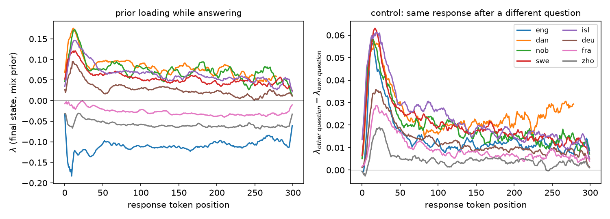
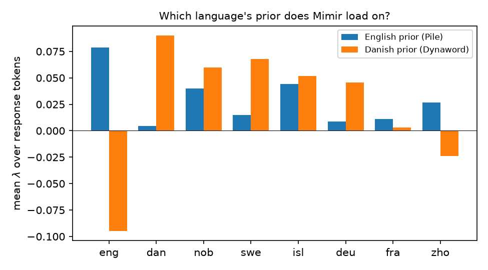
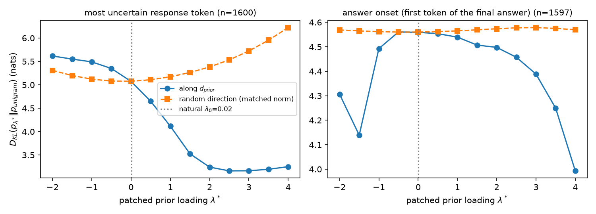
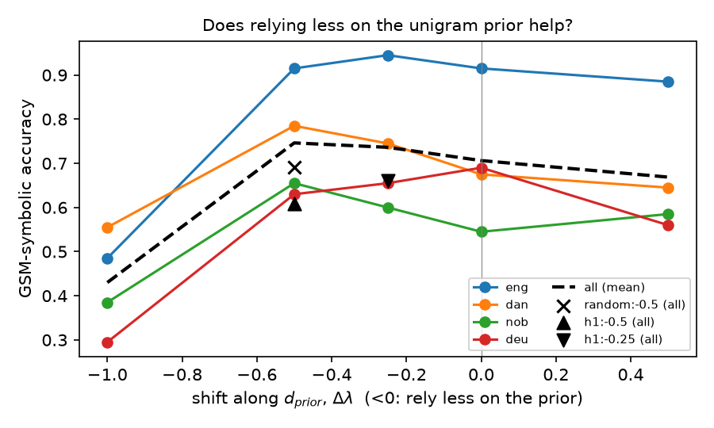

# Mimir's geometry of ignorance

Does [DFM Mimir](https://huggingface.co/danish-foundation-models/DFM-Mimir) (a 1B Danish/English
Hierarchical Reasoning Model, [Schneider-Kamp et al. 2026](https://arxiv.org/abs/2608.13517)) have a
*direction of ignorance*: one direction of the unembedding that encodes the unigram prior, which the model
leans on when it is unsure ([Liu et al. 2026](https://arxiv.org/abs/2609.02959))? We test it while Mimir solves
math word problems from [multilingual GSM-symbolic](https://github.com/centre-for-humanities-computing/multilingual-gsm-symbolic)
in 8 languages.

**TL;DR**

1. **The direction exists, and there is one per language.** A single direction of Mimir's unembedding reconstructs the
   English unigram prior (R² = 0.73, nKL = 0.11) and another the Danish one (R² = 0.81, nKL = 0.14).
   An emulated random initialisation gets R² = 0.05, nKL = 0.95. The two directions are orthogonal
   (cos = −0.02). The paper studied English-dominant models only, where one direction was enough.
2. **The prior is causally active.** Patching λ along `d_prior` at the most uncertain response token moves the
   prediction toward the unigram prior: KL drops from 5.6 to 3.2 nats as λ\* goes from −2 to 2. A random
   direction with the same norm does not do this.
3. **Mimir barely uses the prior when it does math** (|λ| ≤ 0.12, against ≈ 0.4 for Llama‑3.2‑3B on WikiText).
   What little prior it uses matches the answer's language: Nordic answers load on the Danish prior and
   English answers on the English one. That language signature only shows up in the last H‑module
   application. Earlier applications in the recurrence all sit at λ < 0.
4. **λ does not predict errors** (pooled AUROC 0.52; mean token entropy gets 0.73). Replacing the question
   with a different one raises λ in all 8 languages, but only by +0.006 to +0.025.
5. **Side finding: in Danish, Norwegian and Icelandic, Mimir often skips the reasoning.** It answers
   straight away with `\boxed{…}` in 32% / 52% / 35% of cases, and those answers are mostly wrong (17–22%).
   When it does reason, it gets 89% / 93% / 40% right. It never does this in English.
7. **On EuroEval it is a wash overall, and task-dependent** (§7). At Δλ = −0.25 / −0.5 the mean change over 27
   Danish+English datasets is +0.7 / −0.0 points (11W/12L and 11W/15L). Zebra puzzles (+6.3 / +7.4) and NER
   (+1.6 / +2.3) improve at both doses; reading comprehension (−1.1 / −4.8), translation (+0.5 / −2.1) and
   tool-calling (−0.4 / −1.4) get worse.
6. **Relying less on the prior helps only by fixing that habit** (§6). Subtracting a little prior at the output
   (Δλ = −0.5) raises accuracy by 4 points overall (dan +11, nob +11, eng ±0, deu −6). Almost all of the gain comes
   from fewer direct answers. On problems Mimir already reasons through, it does not help and sometimes hurts.

## Setup

* **Model**: `danish-foundation-models/DFM-Mimir` (v1) in fp32 with the Gemma‑4 chat template and a PrefixLM mask
  (the prompt is one bidirectional block), as the model card requires. Decoding is greedy, with at most 768 new
  tokens.
* **Data**: [`danish-foundation-models/multilingual-gsm-symbolic`](https://huggingface.co/datasets/danish-foundation-models/multilingual-gsm-symbolic):
  the first 2 synthetic variants of each of the 100 templates, giving 200 problems per language for
  eng, dan, nob, swe, isl, deu, fra and zho (1,600 in total). Each prompt uses the instruction for its language
  from the `multilingual-gsm-symbolic` package. We score the last `\boxed{}`, or the last number if there is none
  (Mimir answers English with "The final answer is: $X$").
* **Prior fit** (paper §3.3 / App. B): we count unigrams over 100M tokens of `monology/pile-uncopyrighted` (English) and
  100M tokens of `danish-foundation-models/danish-dynaword` (Danish), plus an equal-weight mix. We then fit
  `W d ≈ log p_unigram` by OLS on mean-centred rows and set `λ = ⟨d̂, y⟩ / β`.
  **Deviation from the paper:** the support is the 32k most frequent tokens instead of 70% of the vocabulary. Gemma‑4's
  262k vocabulary is massively multilingual, and most of it never occurs in English or Danish text: only 169k / 101k
  distinct tokens appeared in 100M tokens. With 70% coverage the fit degrades (nKL 0.60 for English). The sweep
  is in `results/prior_fit.json`.
* **Reading λ through the recurrence**: Mimir runs `L L L H L L L H`. Each stack ends in a weightless RMSNorm, so
  the output of every module application lives in the same space as the final prediction state. We read λ from
  all 8 applications, a logit lens that comes for free.
* **Controls / interventions**: (a) teacher-force the same response after a *different* question; (b) patch
  `y ← y + (λ* − λ0) d_prior` (paper eq. 8) against a random unit direction with the same norm. We patch at two
  places: the most uncertain response token and the first token of the final answer.

## Results

### 1. Mimir encodes an English and a Danish unigram prior on (nearly) orthogonal directions


| prior | R² | nKL | β |
|---|---|---|---|
| English (Pile) | 0.73 | 0.110 | 19.9 |
| Danish (Dynaword) | 0.81 | 0.144 | 35.8 |
| equal mix | 0.77 | 0.165 | 20.4 |
| mix, emulated random init | 0.05 | 0.948 | 11.2 |

For comparison, the paper reports R² 0.77–0.83 and nKL 0.06–0.08 for Gemma‑3 and Qwen‑2.5. cos(d_en, d_da) = −0.02.

### 2. Accuracy and the "no reasoning" failure mode

| lang | acc | direct-answer rate | acc (direct) | acc (with reasoning) |
|---|---|---|---|---|
| eng | 0.92 | 0.00 | – | 0.92 |
| dan | 0.68 | 0.32 | 0.22 | 0.89 |
| nob | 0.55 | 0.52 | 0.18 | 0.93 |
| swe | 0.69 | 0.09 | 0.06 | 0.76 |
| isl | 0.32 | 0.35 | 0.17 | 0.40 |
| deu | 0.69 | 0.01 | 0.00 | 0.69 |
| fra | 0.73 | 0.00 | – | 0.73 |
| zho | 0.63 | 0.00 | – | 0.63 |

### 3. Prior loading λ while answering

| lang | λ (mix) | λ (English prior) | λ (Danish prior) | λ after a different question | AUROC error (mean λ) | AUROC error (mean entropy) |
|---|---|---|---|---|---|---|
| eng | −0.113 | 0.079 | −0.095 | −0.097 | 0.60 | 0.65 |
| dan | 0.070 | 0.005 | 0.090 | 0.095 | 0.14 | 0.92 |
| nob | 0.047 | 0.040 | 0.060 | 0.066 | 0.09 | 0.94 |
| swe | 0.056 | 0.015 | 0.068 | 0.082 | 0.51 | 0.74 |
| isl | 0.051 | 0.044 | 0.052 | 0.075 | 0.41 | 0.60 |
| deu | 0.030 | 0.009 | 0.046 | 0.045 | 0.60 | 0.66 |
| fra | −0.027 | 0.011 | 0.003 | −0.017 | 0.52 | 0.57 |
| zho | −0.058 | 0.027 | −0.024 | −0.052 | 0.46 | 0.49 |

Pooled AUROC: mean λ 0.52, mean entropy 0.73. On reasoning responses only: 0.54 and 0.69. The Danish and
Norwegian λ AUROCs are far *below* 0.5 because direct answers are short, carry almost no prior (λ ≈ 0.01) and are
mostly wrong. In other words, λ there picks up "did not reason", not "is uncertain".





### 4. Prior loading through the HRM recurrence


Every intermediate module application has λ < 0 in every language. The final H‑module application is where λ
splits by language: English goes down to −0.11 on the mix prior, while the Nordic languages go up to +0.05–0.07.

### 5. Steering along `d_prior`



At the most uncertain token, raising λ\* pulls the prediction toward the unigram prior, and a random direction with
the same norm does not. This matches the paper's Fig. 4. At the first token of the answer, the prediction is very
confident: it only changes at extreme values. At λ\* = −2, the probability of the original answer token drops from
0.90 to 0.09.

### 6. Does relying less on the prior improve accuracy?

We steer during generation: on every forward pass, we shift a module output along the mixed-language `d_prior` by Δλ
(`src/steer_gsm.py`). We do this for eng, dan, nob and deu, 200 problems each, scored against the unsteered run
(`final:0`) on the same 800 problems.

* `final:Δ` shifts the final prediction state. This is exactly `logits + Δ·W d_prior ≈ logits + Δ·log p_unigram`, i.e.
  a tempered subtraction of the prior (Δ < 0), much like PMI or contrastive decoding.
* `h1:Δ` shifts the output of the first H-module application. That change flows through the second cycle, so it is an
  internal intervention rather than a logit transform.
* `random:-0.5` is a control: a random direction with the same norm.



| config | eng | dan | nob | deu | all | Δ vs baseline (wins↑/losses↓) | McNemar p | direct-answer rate |
|---|---|---|---|---|---|---|---|---|
| final:−1 | 0.485 | 0.555 | 0.385 | 0.295 | 0.430 | −0.276 (60↑/281↓) | 3e‑35 | 0.00 |
| final:−0.5 | 0.915 | **0.785** | **0.655** | 0.630 | **0.746** | **+0.040** (96↑/64↓) | 0.014 | 0.08 |
| final:−0.25 | **0.945** | 0.745 | 0.600 | 0.655 | 0.736 | +0.030 (58↑/34↓) | 0.016 | 0.14 |
| **final:0 (baseline)** | 0.915 | 0.675 | 0.545 | **0.690** | 0.706 | – | – | 0.21 |
| final:+0.5 | 0.885 | 0.645 | 0.585 | 0.560 | 0.669 | −0.038 (57↑/87↓) | 0.015 | 0.19 |
| h1:−0.25 | 0.920 | 0.625 | 0.420 | 0.675 | 0.660 | −0.046 (14↑/51↓) | 4e‑6 | 0.26 |
| h1:−0.5 | 0.915 | 0.495 | 0.360 | 0.665 | 0.609 | −0.098 (16↑/94↓) | 1e‑14 | 0.33 |
| random:−0.5 | 0.920 | 0.695 | 0.515 | 0.635 | 0.691 | −0.015 (35↑/47↓) | 0.22 | 0.19 |

Accuracy split by what the baseline did on each problem:

| config | dan: baseline reasoned (n=136) | dan: baseline answered directly (n=64) | nob: reasoned (n=97) | nob: directly (n=103) | deu (n=199) |
|---|---|---|---|---|---|
| final:0 | 0.890 | 0.219 | 0.928 | 0.184 | 0.693 |
| final:−0.25 | 0.897 | 0.422 | 0.866 | 0.350 | 0.658 |
| final:−0.5 | 0.882 | 0.578 | 0.835 | 0.485 | 0.633 |

**Answer: only partly, and not for the reason you might hope.**

* A mild prior subtraction at the output (Δ = −0.25 to −0.5) raises accuracy by 3–4 points (p ≈ 0.015). A random
  direction with the same norm does not (−1.5, n.s.), and adding prior (+0.5) hurts. So the effect is specific to
  `d_prior`.
* Almost all of the gain comes from one failure mode: answering directly without reasoning. In Danish this drops from
  32% to 9%, and in Norwegian from 52% to 22%. Problems the baseline answered directly go from 22% → 58% correct (dan)
  and 18% → 49% (nob).
* On problems the baseline already reasoned through, removing prior does **not** help. Danish is flat (0.89 → 0.88),
  English gains a little (+3 at −0.25), and Norwegian (−9) and German (−6) get *worse*. Pushing harder (Δ = −1)
  breaks the model in every language (43%).
* Lowering prior *inside* the recurrence (after H1) hurts, and it *increases* direct answering (dan 32% → 56%).
* Read the per-Δ numbers with care: Δ was chosen on the same 200 problems per language that it is evaluated on, with
  no held-out split. The sign pattern is consistent across Δ = −0.25 and −0.5, though.

Bottom line: steering λ is a cheap decoding-time fix for Mimir's "skip the reasoning" habit in Danish and Norwegian
(+11 points on both, unchanged English). It does not make Mimir reason better. When Mimir reasons, the small amount of
prior it uses is not what holds it back.

### 7. Does it improve EuroEval? Mostly no, except on tasks that need reasoning

EuroEval 18.3.0, Mimir v1, zero-shot, validation split, 1 iteration, only on the Danish and English
datasets (29 benchmarks, 27 scored: IFEval-da and IFEval errored on invalid output). Baseline vs. the same
run with the final-state intervention at Δλ = −0.25 and −0.5. The intervention is applied inside vLLM by
patching `HrmTextForCausalLM.compute_logits`, which adds `Δ·W d_prior` to the logits. This is the same
operation as the HF hook in §6, and it also reaches the log-probabilities used to score multiple-choice
answers (`src/patch/sitecustomize.py`, `src/run_euroeval.sh`).

| task | n | Δ (−0.25) | Δ (−0.5) |
|---|---|---|---|
| logical-reasoning (zebra puzzles) | 2 | **+6.32** | **+7.36** |
| named-entity-recognition | 2 | +1.55 | +2.33 |
| european-values | 2 | +1.88 | +0.84 |
| summarization | 2 | +1.27 | +0.10 |
| sentiment-classification | 2 | +0.39 | −0.19 |
| common-sense-reasoning | 2 | +0.05 | +1.15 |
| linguistic-acceptability | 2 | +0.19 | −0.48 |
| knowledge | 3 | +0.25 | −0.96 |
| hallucination | 2 | −0.20 | −0.35 |
| tool-calling | 2 | −0.40 | −1.38 |
| reading-comprehension | 2 | −1.09 | −4.83 |
| translation | 2 | +0.47 | −2.10 |
| word-in-context | 1 | −3.35 | −2.51 |
| **all** | 27 | **+0.68** (11W/4T/12L) | **−0.02** (11W/1T/15L) |

Largest single moves (Δ = −0.5): zebra-puzzles-easy-da 50.8 → 60.4, dansk (NER) 44.0 → 47.4, multi-wiki-qa-da
80.9 → 73.0, flores-en-da 64.5 → 60.3.

**Answer: no, a small threshold does not improve overall EuroEval performance.** The mean is within noise at
both doses (+0.7 and −0.0 points, wins ≈ losses). What does move is consistent across the two doses and
sensible:

* Tasks where the model has to *construct* an answer token by token from a puzzle get better and better as more
  prior is removed: zebra puzzles +6.3 → +7.4 (da +7.4 → +9.6), NER +1.6 → +2.3. These are the same tasks where
  the model is least able to lean on high-frequency continuations.
* Tasks that are mostly faithful copying or where the frequent continuation *is* the right answer get worse with
  more removal: reading comprehension −1.1 → −4.8, translation +0.5 → −2.1, tool-calling −0.4 → −1.4,
  word-in-context −3.4.

So the prior direction is not a free win: it trades "stop guessing the frequent thing" against "keep the answer
grounded in the input". The dose-response (same sign, larger at −0.5) is the reason to believe the task-level
effects; the aggregate is not evidence of anything.

Caveat on absolute numbers: vLLM's `hrm_text` implementation does not apply Mimir's PrefixLM attention mask, so
every number above (both arms) is measured with a strictly causal mask, which is not the input distribution the
model card specifies. DANSK, for instance, scores 44.0 F1 here against ~96 in the Mimir report. The
baseline/steered contrast is unaffected, but the levels are not comparable to published EuroEval numbers.

## Reproduce

```bash
uv sync
bash run.sh          # ≈1.5 h + ≈4 h for §6 on 4× Quadro RTX 8000; §7 is ≈80 min per EuroEval arm on 1 GPU
uv run src/analyze.py  # only re-aggregates (no GPU): tables + figures from results/
```

| file | what |
|---|---|
| `src/count_unigrams.py` | stream a corpus and count Gemma‑4 tokens |
| `src/fit_prior.py` | OLS fit of `d_prior`, R², nKL, random-init control, support sweep |
| `src/run_gsm.py` | generate, score, teacher-force with hooks on every L/H application, control and steering |
| `src/analyze.py` | tables (`results/summary.json`) and `figures/` |
| `src/steer_gsm.py` | GSM evaluation while steering along `d_prior` (§6) |
| `src/analyze_steer.py` | §6 tables (`results/steer_summary.json`) and `figures/steer_accuracy.png` |
| `src/make_logit_shift.py` | precompute `W d_prior` (§7) |
| `src/patch/sitecustomize.py` | injects the intervention into vLLM's `compute_logits` for EuroEval |
| `src/run_euroeval.sh` | EuroEval run with/without the intervention (`results/euroeval/`) |
| `src/analyze_euroeval.py` | §7 comparison table (`results/euroeval/comparison.md`) |

All raw generations are in `results/gsm/<lang>.jsonl`, and per-token λ / entropy / KL are in `results/gsm/<lang>.npz`.

## Caveats

* We used one checkpoint (Mimir v1, not v1.5), 200 problems per language and greedy decoding.
* The unigram priors come from reference corpora (Pile and Dynaword), not from Mimir's training mixture.
* The support is 32k tokens, not 70% of the vocabulary (see above).
* We only measure λ on response tokens. Under the PrefixLM mask the prompt is bidirectional, so prompt positions do
  not do next-token prediction and the paper's analysis of how λ falls as context builds up does not carry over
  directly.
* Math responses are low-entropy text, so the small λ we see is not directly comparable to the paper's WikiText
  numbers.

## References

* T. J. B. Liu et al. *The Geometry of Ignorance: LLMs Know When to Temper Bayesian Priors.* arXiv:2609.02959 (2026).
* P. Schneider-Kamp et al. *DFM Mimir v1: An Open HRM Delivering Frontier Performance at 1B Parameters Using Only Permissible Post-Training Data.* arXiv:2608.13517 (2026).
* [multilingual-gsm-symbolic](https://github.com/centre-for-humanities-computing/multilingual-gsm-symbolic).
